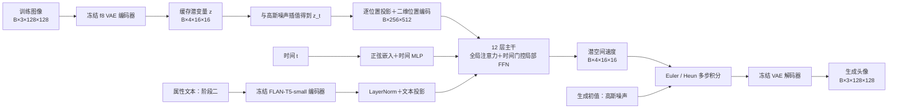

# FaceFlow-Tiny

FaceFlow-Tiny 是一个面向 **128×128 人脸生成**的小型潜空间 Rectified Flow 项目。先训练无条件生成，再从同一个 checkpoint 继续学习笑容、眼镜、发色等属性文本条件；NVIDIA CUDA 和沐曦 MetaX MACA 共用训练入口。

当前生成网络约 **61.50M** 参数，采用 12 层 Transformer、全局注意力与时间门控局部 FFN。这里的“从零训练”指生成主干随机初始化，图像 VAE 和文本编码器使用冻结的预训练权重。文本能力面向 CelebA 的人脸属性，正式长训后的生成质量仍待验证。

## 目录

- [从环境到训练](#从环境到训练)
- [模型架构与训练目标](#模型架构与训练目标)
- [运行配置与多卡训练](#运行配置与多卡训练)
- [可选：记录训练里程碑](#可选记录训练里程碑)
- [常见问题](#常见问题)
- [当前配置的短测与验证](#当前配置的短测与验证)
- [文件组织与参考资料](#文件组织与参考资料)

## 从环境到训练

下面以 **Linux、NVIDIA 单卡、Python 3.12、PyTorch 2.8.0** 为主线。下载或克隆仓库后，进入包含 `train.py` 和 `config.json` 的项目根目录，按顺序执行。每条训练命令都应等上一条结束后再运行；续训时也要先确认原训练进程已退出。

### 1. 建立环境

先准备可用的 NVIDIA 驱动，再创建隔离环境：

```bash
python3.12 -m venv .venv
source .venv/bin/activate
python -m pip install --upgrade pip
python -m pip install torch==2.8.0 --index-url https://download.pytorch.org/whl/cu128
python -m pip install -r requirements.txt
python -c "import torch; print('PyTorch:', torch.__version__); print('GPU available:', torch.cuda.is_available()); print(torch.cuda.get_device_name(0) if torch.cuda.is_available() else 'No GPU')"
mkdir -p data/celeba cache runs outputs
```

确认输出中的 `GPU available` 为 `True`。CUDA 12.8 是已验证环境的安装示例，其他硬件环境可参考 [PyTorch 官方历史版本说明](https://pytorch.org/get-started/previous-versions/#v280) 选择对应构建。`requirements.txt` 不安装或替换 PyTorch，也不要求额外安装 torchvision、flash-attn 或 xformers。

Windows PowerShell 使用下面的环境初始化命令，其余 Python 入口相同：

```powershell
py -3.12 -m venv .venv
.\.venv\Scripts\Activate.ps1
python -m pip install --upgrade pip
python -m pip install torch==2.8.0 --index-url https://download.pytorch.org/whl/cu128
python -m pip install -r requirements.txt
New-Item -ItemType Directory -Force data/celeba, cache, runs, outputs | Out-Null
```

下文代码块的多行续行符 `\` 属于 Bash。PowerShell 中将整条 Python 命令写在一行，或把行末的 `\` 换成反引号。Windows 使用单卡路径；NVIDIA 多卡 NCCL 训练使用 Linux。

### 2. 下载并整理 CelebA

从 [CelebA 官方页面](https://mmlab.ie.cuhk.edu.hk/projects/CelebA.html) 获取 **Align&Cropped Images**、**Train/Val/Test Partitions** 和 **Attributes Annotations**。解压后整理为：

```text
data/celeba/
├── img_align_celeba/
│   ├── 000001.jpg
│   ├── 000002.jpg
│   └── ...
├── list_eval_partition.txt
└── list_attr_celeba.txt
```

`--images` 应直接指向包含 JPG 的目录，避免解压后多套一层同名文件夹。阶段一只需要图像和划分文件，阶段二还需要属性文件。训练使用官方 train 划分；数据集约定为非商业研究使用，下载与使用条件以官方说明为准。仓库不附带数据和模型权重。

### 3. 缓存图像潜变量

```bash
python prepare.py \
  --images data/celeba/img_align_celeba \
  --partition data/celeba/list_eval_partition.txt \
  --cache cache/celeba --split train
```

首次运行会加载 [stabilityai/sd-vae-ft-mse](https://huggingface.co/stabilityai/sd-vae-ft-mse)。图像会中心裁剪、缩放至 128×128、归一化到 `[-1,1]`，再取 VAE posterior mean 并乘以 `0.18215`，保存为 FP16 潜变量。

完成后应有 `cache/celeba/latents.npy` 和 `meta.json`。元数据记录图像顺序、划分、VAE 来源和缩放方式，约 16.3 万张训练图像的潜变量占约 318 MiB。相同图像处理和 VAE 约定下可复用缓存，无需每次训练重新编码。该命令会重建指定目录的图像缓存，已有可用缓存时直接进入下一步。

### 4. 用两次更新检查训练入口

先在独立目录运行，避免把检查权重当成正式训练起点：

```bash
python train.py --config config.json --stage unconditional \
  --cache cache/celeba --output runs/smoke \
  --steps 2 --no-preview
```

看到程序正常退出并生成 `runs/smoke/latest.pt`，说明缓存读取、前后向和 checkpoint 保存路径已走通。`--steps 2` 表示本次额外完成两次成功的优化器更新；`--no-preview` 跳过 VAE 出图。这一步只检查运行流程。

### 5. 无条件训练与续训

从随机初始化开始正式训练，使用新的输出目录，**不传 `--resume`**：

```bash
python train.py --config config.json --stage unconditional \
  --cache cache/celeba --output runs/unconditional \
  --hours 30 --save-every 1800
```

这是前台运行方式。如果希望同时使用里程碑记录器，先看[记录训练里程碑](#可选记录训练里程碑)，采用其中的后台启动方式替代本条命令；两种方式只选一种。

训练会更新 `runs/unconditional/latest.pt`，并保留 `preview-0000000.png` 这类带 step 的预览。预览使用 EMA、固定种子、16 张图和 32 步 Euler。输出中的 `event: update` 包含 step、loss 与本次训练循环的耗时；loss 用于检查训练状态，生成效果需要看固定样例。

时间和步数参数的含义：

| 参数 | 实际行为 |
|---|---|
| `--hours` | CLI 默认 **12 小时**；示例明确传 30，表示本次启动的预算 |
| `--save-every` | 默认 **3600 秒**；示例改为 1800 秒 |
| `--steps N` | 本次额外成功更新数；默认 0，按时间预算运行 |
| `--no-preview` | 保存 checkpoint，跳过自动预览 |
| `--include-prepare-time` | 将缓存元数据记录的图像准备开始时间计入预算，适合刚做完缓存的连续流程 |

按时间运行时，从训练程序启动开始计时，优化循环会在预算结束前 **1800 秒**进入收尾，留给最终保存和预览；因此 30 小时预算的优化阶段约在启动后 29.5 小时结束。设置 `--steps` 后按额外更新数运行，不预留这半小时，但 `--hours` 仍是退出时间限制。保存和采样的实际耗时也应纳入自己的资源安排。

若训练中断，或第一段预算结束后还想继续，确认原进程已退出，再恢复：

```bash
python train.py --config config.json --stage unconditional \
  --cache cache/celeba --output runs/unconditional \
  --resume runs/unconditional/latest.pt \
  --hours 12 --save-every 1800
```

续训的 `--hours 12` 是新的预算。checkpoint 保存模型、EMA、优化器、GradScaler、阶段、更新数、已见样本数、数据读取位置和各 rank 随机数状态；同平台、相同进程数与运行参数可接续恢复。更换平台会恢复权重与优化器，并重建设备随机数流。

### 6. 缓存属性文本

在已完成图像缓存的目录追加文本特征：

```bash
python prepare.py --text --cache cache/celeba \
  --attributes data/celeba/list_attr_celeba.txt
```

首次运行会加载 [google/flan-t5-small](https://huggingface.co/google/flan-t5-small) 的冻结编码器。程序将 CelebA 属性转换为固定顺序的英文描述，只编码去重后的 caption，通过 ID 与每张图像关联。新增文件为 `text.npy`、`text_mask.npy` 和 `caption_ids.npy`，编码器信息会写入 `meta.json`。

当前描述使用 `Smiling`、`Eyeglasses`、`Bangs`、`Bald`、`Black_Hair`、`Blond_Hair` 和 `Brown_Hair`。只陈述正属性；冲突发色省略，秃头样本不再添加头发颜色或刘海。示例：

```text
A portrait of a person with blond hair, wearing eyeglasses, smiling.
```

### 7. 从无条件权重进入文本阶段

```bash
python train.py --config config.json --stage text \
  --cache cache/celeba --output runs/text \
  --resume runs/unconditional/latest.pt \
  --hours 12 --save-every 1800
```

阶段切换保留主干与 AdamW 动量，启用模型中预留的条件模块；主干学习率改为 `5e-5`，条件模块使用 `2e-4`。30 小时和 12 小时都是教程中的预算示例，可按设备和观察结果调整。

恢复已训练的文本 checkpoint 时，继续指定 `--stage text`，并从文本目录加载：

```bash
python train.py --config config.json --stage text \
  --cache cache/celeba --output runs/text \
  --resume runs/text/latest.pt \
  --hours 12 --save-every 1800
```

同阶段恢复会沿用条件权重与优化器状态。训练器的自动预览仍是无条件样例，属性控制效果用下一步的固定 prompt 检查。

### 8. 生成图像

无条件生成：

```bash
python sample.py --checkpoint runs/unconditional/latest.pt \
  --output outputs/unconditional.png
```

属性文本生成：

```bash
python sample.py --checkpoint runs/text/latest.pt \
  --output outputs/text \
  --prompt "A portrait of a person with blond hair, wearing eyeglasses, smiling."
```

默认使用 EMA、16 张图、40 个区间的 Heun 和采样微批 4；文本 CFG scale 为 3。Heun 每个区间评估两次速度场，因此 40 区间对应 80 次速度场求值，启用 CFG 时每次求值另含条件与无条件两条前向。

输出为图片路径时保存网格和同名 JSON；输出为目录时保存 `grid.png`、单张图和 `metadata.json`。可通过 `--count`、`--columns`、`--seed`、`--batch-size` 调整展示，或使用 `--method euler --steps 32`。`--prompts-file` 接收每行一条提示词，按顺序循环分配给样本。所有样本都从高斯噪声开始生成。

## 模型架构与训练目标

### 数据流与主干规格



真实图像只参与缓存与训练。采样时从 `B×4×16×16` 的高斯噪声出发，反复调用速度网络，再由 VAE 解码。

| 部分 | 当前配置 |
|---|---|
| 图像表示 | 冻结 `stabilityai/sd-vae-ft-mse`，f8 压缩，4 通道潜变量 |
| 输入投影 | 每个潜变量位置执行 `Linear(4,512)`，得到 256 个 token |
| 位置与时间 | 固定二维正余弦位置编码；`t×1000` 的 256 维正弦嵌入，经 `256→512→512` MLP |
| 主干 | 12 层、512 维、8 heads，每头 64 维，全局非因果注意力 |
| 时间调制 | adaLN-Zero，分别产生注意力和 FFN 的 shift、scale、残差 gate |
| 局部 FFN | `512→2048→512`，3×3 depthwise convolution 与时间门控 |
| 文本条件 | 冻结 FLAN-T5-small，最长 64 token、输出 512 维；第 4、8、12 层交叉注意力 |
| 输出 | 时间调制 LayerNorm 与 `Linear(512,4)`，恢复 `B×4×16×16` 速度 |

| 参数范围 | 参数量 |
|---|---:|
| 完整生成网络 | **61,501,712** |
| 无条件阶段可训练部分 | **58,082,576** |
| 文本阶段启用的条件模块 | **3,419,136** |

以上统计不包含冻结 VAE 和文本编码器。训练入口按 `config.json` 的 `model` 实例化网络，当前规格以该配置为准。改变宽度、深度等结构后，需要新建训练，不能把不同结构的 checkpoint 直接作为断点恢复。

VAE 的缓存与解码使用相同约定：

$$
z=0.18215\cdot\operatorname{mean}(q_\phi(\cdot\mid x)),
\qquad \hat x=D_\phi(z/0.18215).
$$

使用 posterior mean 使每张图像对应固定缓存；f8 在 128px 下保留 16×16 网格，为局部空间混合提供位置结构。

### 时间门控局部 FFN

每个 block 先执行时间调制的全局自注意力；指定层插入文本交叉注意力；最后执行时间调制的局部 FFN。全局注意力负责跨区域信息交换，局部卷积为相邻潜变量位置引入空间偏置。

令经过 FFN 侧 AdaLN 的输入为 $h$，时间嵌入为 $e_t$，则：

$$
u=W_1h,\qquad
 g_\ell(t)=\sigma(\operatorname{MLP}_\ell(e_t)),
$$

$$
\operatorname{LocalFFN}_\ell(h,t)
=W_2\operatorname{SiLU}\left(u+g_\ell(t)\operatorname{DWConv}_{3\times3}(u)\right).
$$

卷积前将 token 还原为 `B×2048×16×16` 网格，卷积后恢复 token 顺序。卷积 stride 为 1、padding 为 1、groups 为 2048；每层独立的门控 MLP 为 `512→32→1`，输出按通道和空间广播。

局部门控的最后一层零初始化，因此初始值为 0.5；adaLN-Zero 的残差 gate 则控制整个注意力或 FFN 更新，两者作用不同。adaLN 调制层、最终速度输出层和文本交叉注意力输出投影均采用零初始化。相对同宽深的普通两层 FFN，局部卷积与时间门控合计增加 443,148 个参数，约 0.44M。

局部空间混合借鉴 [SANA](https://arxiv.org/abs/2410.10629)，潜空间 Transformer 与 adaLN 参考 [DiT](https://arxiv.org/abs/2212.09748)。时间门控是本项目的设计探索，其质量和效率收益尚需专门实验验证。

### Rectified Flow 与采样

统一约定 **$t=0$ 为噪声，$t=1$ 为数据**。对干净潜变量 $z$、高斯噪声 $\epsilon$ 和独立采样的时间 $t$：

$$
\epsilon\sim\mathcal N(0,I),\quad t\sim U(0,1),\quad
z_t=(1-t)\epsilon+t z.
$$

网络直接回归速度，使用 FP32 MSE：

$$
v^\star=z-\epsilon,\qquad
\mathcal L=\mathbb E\left[\|v_\theta(z_t,t,c)-(z-\epsilon)\|_2^2\right].
$$

生成时从高斯噪声出发，沿 $t:0\rightarrow1$ 积分 $dz_t/dt=v_\theta(z_t,t,c)$。训练预览使用 Euler，`sample.py` 默认使用 Heun，两者都使用 EMA 权重。文本阶段通过整条条件 10% 的随机丢弃学习无条件分支，默认 CFG 为：

$$
v_{\mathrm{cfg}}=v_u+3(v_c-v_u).
$$

### 两阶段训练如何衔接

文本编码器始终冻结，特征离线缓存。文本经过可训练的 LayerNorm 和线性投影后，在第 4、8、12 层作为交叉注意力的 Key/Value；图像 token 作为 Query。padding mask 保留，无条件样本使用可学习 null token，并保证至少有一个有效注意力位置。

第一阶段中，条件模块已存在于完整模型和 checkpoint 内，但冻结并完全旁路。切换阶段时先恢复主干及原优化器状态，再加入条件参数组，保留主干 AdamW 动量；主干 EMA 沿用，条件 EMA 从当前条件权重初始化。恢复已有文本 checkpoint 时直接恢复两组状态，不重复初始化。

| 训练设置 | 默认值 |
|---|---|
| 优化器 | AdamW，非 fused，betas `(0.9, 0.999)`，weight decay `0.01` |
| 学习率 | 无条件 `2e-4`；文本阶段主干 `5e-5`、条件模块 `2e-4` |
| Warmup | 每阶段前 500 次成功更新线性升温，之后保持 |
| 梯度 | 梯度累积；unscale 后裁剪 global norm 至 1.0 |
| 精度 | FP16 AMP + GradScaler；LayerNorm 和 loss 显式使用 FP32，math 注意力也使用 FP32 |
| EMA | FP32，decay `0.999`，仅在优化器成功更新后推进 |
| 种子 | 42，各 rank 使用不同且可恢复的随机数流 |

SDPA 的内部计算由 PyTorch 对应实现处理。AMP 溢出跳过优化步骤时，不推进成功更新数、EMA 或 warmup。

## 运行配置与多卡训练

运行参数的优先级为：**命令行 > 平台内阶段覆盖 > 平台 profile > 共享训练配置**。算法参数位于 `config.json` 的 `training`，硬件运行选项位于 `runtime`；`--platform auto` 默认自动识别，也可显式指定 `nvidia` 或 `metax`。

| 平台 / 阶段 | 每卡微批 | 全局 batch | 双卡时累积次数 | 通信 |
|---|---:|---:|---:|---|
| NVIDIA，两个阶段 | 16 | 64 | 2 | NCCL / DDP |
| MetaX，无条件 | 64 | 256 | 2 | CPU / Gloo 梯度平均 |
| MetaX，文本 | 32 | 192 | 3 | CPU / Gloo 梯度平均 |

单卡 NVIDIA 默认累积 4 次。全局 batch、微批与进程数必须满足：

$$
\mathrm{accumulation}=\frac{\mathrm{global\_batch}}
{\mathrm{world\_size}\times\mathrm{micro\_batch}}\in\mathbb N^+.
$$

显存不足时可先降低 `--micro-batch`，保持整除关系。例如单卡 NVIDIA 使用 `--global-batch 64 --micro-batch 8`，累积 8 次。双 MetaX 无条件可使用已短测的 `--global-batch 192 --micro-batch 48`；若保持全局 256，可改为微批 32、累积 4 次。改变全局 batch 会改变每张图对应的优化器与 EMA 更新频率，学习率不会自动按比例调整。

其他运行覆盖：`--precision fp16|bf16|fp32`、`--attention math|sdpa`、`--cache-device cpu|cuda`、`--foreach/--no-foreach` 和 `--compile/--no-compile`。只有潜变量可常驻 GPU；去重文本特征留在 CPU，按批搬运。

### NVIDIA 多卡

Linux 上将教程中的 `python train.py` 替换为分布式入口，例如双卡无条件训练：

```bash
python -m torch.distributed.run --standalone --nproc_per_node=2 train.py \
  --config config.json --stage unconditional \
  --cache cache/celeba --output runs/unconditional \
  --hours 30 --save-every 1800
```

首次训练选择空目录，不与单卡进程同时写入同一个 run。文本阶段使用相同入口，替换 `--stage`、`--output` 和 `--resume` 即可。NVIDIA 单卡已完成功能验证，多卡入口使用原生 DDP/NCCL，尚未在 NVIDIA 多卡硬件上实测。

### 沐曦 MetaX

使用与服务器驱动匹配的 MACA/mcPyTorch 环境，并继承厂商安装的 PyTorch：

```bash
python -m venv --system-site-packages .venv
source .venv/bin/activate
python -m pip install -r requirements.txt
```

不要在这个环境中再执行 NVIDIA 的 PyTorch 安装命令。数据准备、训练和采样命令保持一致，双卡采用上面的分布式入口，必要时加 `--platform metax`。

MACA 的设备接口沿用 `cuda` 名称，不能据此判断为 NVIDIA。项目根据厂商版本标记和设备名称选择 profile。本项目测试的共享 N260 环境无法建立 MCCL 所需流池，因此 MetaX profile 显式使用 `gloo_cpu`：GPU 完成梯度累积，CPU/Gloo 对梯度平均后回写 GPU。它是配置选择，不是自动异常回退。`nccl` 模式对应原生 DDP，MACA 底层使用 MCCL。

MetaX profile 默认启用 FP16、SDPA、foreach AdamW、编译和 GPU 潜变量缓存；文本阶段自动覆盖 batch。入口按 profile 的 `environment` 补充 MPS/队列环境变量，shell 已设置的同名变量优先。依据见[官方 MPS 说明](https://vllm-metax.readthedocs.io/en/stable/release/common/common_zh.html)与[官方队列策略指南](https://developer.metax-tech.com/api/client/document/preview/567/C500_RuntimeAPIProgrammingGuide_CN.html)。共享服务器启动前应分别检查每张卡的空闲显存。

## 可选：记录训练里程碑

`train.py` 定期更新 `latest.pt`，旧版本会被覆盖。`record.py` 是独立记录进程，用来归档指定时点的完整 checkpoint，并用固定噪声生成可对照的网格。

### Linux 后台启动与日志 / PID

如需记录器，**在首次无条件训练开始前**，用下面的方式替代教程第 5 步的前台启动。不要在已有训练运行时再启动一份。代码会在目标目录存在时停止该启动分支，避免覆盖已有 run：

```bash
if [ -e runs/unconditional ]; then
  printf '%s\n' 'runs/unconditional 已存在，请先确认已有训练及其记录。'
else
  mkdir runs/unconditional
  nohup .venv/bin/python -u train.py \
    --config config.json --stage unconditional \
    --cache cache/celeba --output runs/unconditional \
    --hours 30 --save-every 1800 \
    > runs/unconditional/train.log 2>&1 < /dev/null &
  printf '%s\n' "$!" > runs/unconditional/launcher.pid
fi
```

该示例是单卡启动，记录的 PID 对应训练进程；多卡时将 `.venv/bin/python -u train.py` 替换为 `.venv/bin/python -u -m torch.distributed.run --standalone --nproc_per_node=2 train.py`，记录的就是分布式启动器 PID。

随后在项目根目录启动记录器：

```bash
nohup .venv/bin/python -u record.py \
  --config config.json --run runs/unconditional \
  --log runs/unconditional/train.log \
  --start-hour 10 --every-hours 5 --capture-now \
  > runs/unconditional/record.log 2>&1 < /dev/null &
```

训练器本身不会生成日志文件或 `launcher.pid`，上面的 shell 命令负责创建。记录器从 `--run` 目录读取 PID，也可显式传 `--pid`。如果训练已经启动，只需给记录器提供该次训练已有的日志和真实进程 PID；没有保存 stdout 时，不应拿别次日志补作本次里程碑时间依据。

### 记录内容与时间口径

- `--capture-now` 归档当前已保存的 checkpoint 作为基线；若尚未出现 `latest.pt`，记录器会正常等待首次保存。
- 随后保留 10、15、20、25 小时等目标时点后，首个满足时长要求的已保存权重。时长取 checkpoint 对应 step 之前最近一条 update 日志的 `elapsed_s`，是保守下界，不是精确到点的内存快照。
- `elapsed_s` 从本次训练循环开始计时，早于循环的环境初始化、模型建立和缓存加载不包含在内；它与 `--hours` 从程序启动计时的口径不同。
- 训练进程退出后，额外归档最后已保存的权重，并标明实际日志时长。记录器不恢复已被 `latest.pt` 覆盖的历史权重，也不自动挑选 best。

默认每次生成 32 张图，4 行 × 8 列，原生网格为 1024×512；使用 EMA、40 区间 Heun、微批 4。初始噪声只生成一次，存入 `records/noise.npy`，后续所有里程碑复用并记录 SHA256。它与训练器的 16 张快速预览采用不同噪声生成路径，两者不构成逐位置对照。

`runs/unconditional/records/` 中保存 checkpoint、PNG 网格、采样 JSON、`index.json`、`history.csv` 和带实际小时数 / step 标题的 `comparison.png`。每份完整 checkpoint 约 0.96 GB，按保留数量预留磁盘空间。

记录采样使用独立进程，默认 GPU 0、PyTorch 分配器上限 3 GiB；初始化后的空闲显存小于 4 GiB 或采样 OOM 时，先保留 checkpoint，延后出图。设置位于 `config.json` 的 `recording`。单次手工归档可运行：

```bash
python record.py --config config.json --run runs/unconditional \
  --log runs/unconditional/train.log --once
```

记录时钟只对应一次连续训练启动。若后续恢复训练还需要记录，使用新的输出目录、日志和 PID，`--resume` 指向上一段 checkpoint；旧 `records/` 作为上一段记录保留，避免混用重置后的日志时钟。记录器默认展示无条件样例，文本控制另用固定提示词评估。

## 常见问题

**权重已下载，如何使用本地目录？**

图像缓存时给 `prepare.py` 增加 `--vae models/sd-vae-ft-mse`；文本缓存时增加 `--text-encoder models/flan-t5-small`。目录需包含对应的模型配置、权重，文本目录还需 tokenizer 文件。缓存会记录组件来源，训练 checkpoint 再沿用这些信息。

迁移机器后，自动预览可通过 `train.py --vae models/sd-vae-ft-mse` 覆盖 VAE 路径；采样使用 `sample.py --vae models/sd-vae-ft-mse --text-encoder models/flan-t5-small` 覆盖两者。不传文本提示词时，采样不会加载文本编码器。离线运行前先在可联网环境准备完整组件目录。

**显存不足怎么办？**

先降低微批并核对全局 batch 整除关系，再尝试 `--cache-device cpu`。训练可加 `--no-preview`，之后单独运行 `sample.py`；采样可降低 `--batch-size`。多卡是每卡一份完整模型，显存预算按单卡计算。

**为什么文本训练要求额外缓存？**

第一阶段无需加载文本编码器；第二阶段读取 `text.npy`、mask 和 caption ID。若报缺少文本特征，先执行第 6 步，并确认训练和文本准备使用同一个 `--cache`。模型识别的是数据覆盖的人脸属性，建议先用教程中的英文属性组合检查。

**如何给自己的设备测速？**

```bash
python train.py --config config.json --benchmark \
  --output outputs/benchmark --warmup 20 --steps 50 \
  --global-batch 64 --micro-batch 16
```

测速使用合成潜变量，不下载数据或预训练权重，但会执行前后向、梯度同步、优化器和 EMA；`--stage text` 可测合成文本路径。结果在 `benchmark.json`，包含吞吐、loss、运行参数、预热时间及分配 / 保留显存峰值。多卡测速使用分布式入口。比较候选时保持模型、全局 batch 和测量更新数一致。

## 当前配置的短测与验证

以下为 **2026-10-27** 的 61.50M 配置短测。双 MetaX N260 共享环境，MACA `3.5.3.20`、PyTorch `2.8.0+metax3.5.3.9`；FP16、SDPA、编译、GPU 潜变量缓存与 CPU/Gloo 梯度平均。使用 162,770 条合成潜变量，预热 10 次成功更新后计时 30 次，均为单次测量。

| 阶段 | 每卡微批 / 全局 batch / 累积 | images/s | 分配峰值 GiB | 保留峰值 GiB | 系统进程采样峰值 GiB/卡 |
|---|---|---:|---:|---:|---:|
| 无条件，较低显存候选 | 48 / 192 / 2 | 179.82 | 5.30 | 5.38 | 6.34 |
| 无条件，当前 MetaX 默认 | 64 / 256 / 2 | 203.24 | 6.49 | 6.52 | 7.48 |
| 文本，当前 MetaX 默认 | 32 / 192 / 3 | 153.86 | 4.30 | 4.58 | 5.58 |

系统进程显存由 `mx-smi` 每 2 秒采样，PyTorch 分配和保留峰值分别取最占用 rank；这些口径不能互相替代。结果包含完整训练更新，受共享负载影响，不直接代表长训速度或同等质量下的性能。

已记录的功能验证包括：

- 当前配置在 NVIDIA RTX 5070 Laptop 8GB、PyTorch 2.8.0/cu128 上完成单卡两次成功更新，loss 有限，分配 / 保留峰值约 2.72 / 2.78 GiB；未预热，仅作功能检查。
- 当前 MetaX 双卡配置使用真实潜变量缓存完成两次更新、保存、恢复后再更新两次，并调用本地 VAE 生成预览。最终累计 4 次更新，已见样本数为 1,024，系统进程显存采样峰值约 7.53 GiB。
- 模型形状、条件 mask 与丢弃、RF / Euler / Heun / CFG、梯度累积与 CPU 梯度平均、无条件恢复到文本阶段及文本同阶段恢复已完成必要检查。

短步运行证明相应路径可执行，正式长训的人脸质量、属性遵循和模块收益仍需结合实际训练记录评估。仓库不附带上述验证脚本、训练数据、权重或调优日志。

## 文件组织与参考资料

```text
.
├── README.md             项目说明、架构与训练教程
├── config.json           共享算法参数和平台运行配置
├── prepare.py            图像 / 文本特征缓存
├── train.py              训练、恢复、自动预览与测速
├── sample.py             EMA 采样、网格与单图保存
├── record.py             独立的里程碑归档和固定噪声对照
├── faceflow/
│   ├── model.py          注意力、adaLN、局部 FFN 和文本条件
│   ├── flow.py           RF 损失、Euler / Heun 与 CFG
│   ├── data.py           CelebA 读取、属性描述和缓存加载
│   └── runtime.py        平台、通信、混合精度、EMA 和 checkpoint
├── requirements.txt
└── LICENSE
```

- [DiT](https://arxiv.org/abs/2212.09748)：潜空间 Transformer 与 adaLN-Zero 的基础结构。
- [SANA](https://arxiv.org/abs/2410.10629)：局部 Mix-FFN 的主要参考；本项目使用简化局部分支并增加时间门控。
- [SnapGen++](https://arxiv.org/abs/2601.08303)：全局与局部计算分配的设计参考。
- [MiniT2I 技术报告](https://peppaking8.github.io/minit2i/)：紧凑文本条件接口与训练预算的近邻研究。
- [JiT](https://arxiv.org/abs/2511.13720)：像素空间预测参数化的参考；本项目采用潜空间速度回归。
- [VAE 模型卡](https://huggingface.co/stabilityai/sd-vae-ft-mse)、[FLAN-T5-small 模型卡](https://huggingface.co/google/flan-t5-small)：冻结组件来源。
- [mcPyTorch 官方仓库](https://github.com/MetaX-MACA/mcPytorch)：MetaX 平台适配参考。

原创代码和文档采用 [MIT 许可](LICENSE)。CelebA、预训练权重及引用材料分别遵循各自的使用条件和许可。
