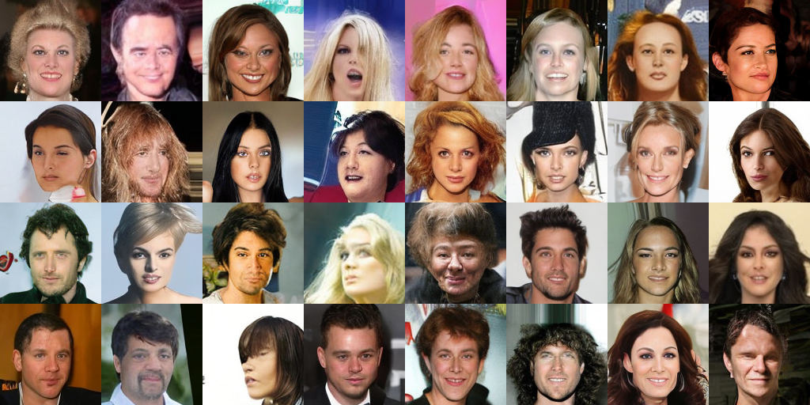
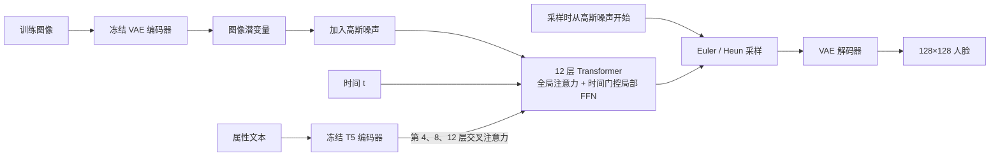

# FaceFlow-Tiny

- [简介](#简介)
- [启动训练方法](#启动训练方法)
- [模型架构设计](#模型架构设计)
- [常见问题](#常见问题)
- [参考论文](#参考论文)

## 简介

一个生成 128×128 人脸的小项目。生成主干约 61.5M 参数，从随机初始化开始训练；VAE 和文本编码器使用冻结的预训练权重。先学习无条件人脸生成，再接着训练笑容、眼镜、发色等文本属性。

### 训练结果



### 项目结构

```text
MyT2I/
├── faceflow/               Python 代码
│   ├── __init__.py
│   ├── prepare.py          图像和文本缓存
│   ├── train.py            训练、续训
│   ├── sample.py           生成图片
│   ├── record.py           训练里程碑记录
│   ├── model.py            生成网络
│   ├── flow.py             RF 损失和采样
│   ├── data.py             数据读取
│   └── runtime.py          优化器、EMA、检查点
├── configs/
│   └── default.json        默认训练配置
├── assets/
│   └── result_show.png     展示图片
├── requirements.txt
├── README.md
└── LICENSE
```

运行后，数据、缓存、训练权重和生成图片分别放在 `data/`、`cache/`、`runs/`、`outputs/`，这些目录不提交到仓库。

## 启动训练方法

下面使用 NVIDIA 单卡。默认配置按 8GB 显存设置：FP16、每次送入 GPU 4 张图、全局 batch 64，通过梯度累积完成更新；缓存放在 CPU，不启用编译。数据准备默认 batch 4，采样默认 batch 2。

所有命令都在项目根目录执行，Linux 和 Windows PowerShell 均可使用。

### 1. 安装环境

先安装 NVIDIA 驱动和 Conda，再执行：

```bash
conda create -n faceflow python=3.12 -y
conda activate faceflow
python -m pip install torch==2.8.0 --index-url https://download.pytorch.org/whl/cu128
python -m pip install -r requirements.txt
python -c "import torch; print(torch.__version__); print(torch.cuda.is_available())"
```

最后一行应输出 `True`。这里使用 CUDA 12.8 版 PyTorch；驱动不支持时，按 [PyTorch 安装说明](https://pytorch.org/get-started/previous-versions/#v280) 选择相应版本。

### 2. 准备数据

从 [CelebA 官网](https://mmlab.ie.cuhk.edu.hk/projects/CelebA.html) 下载对齐图像、数据划分和属性文件，解压成下面的目录：

```text
data/celeba/
├── img_align_celeba/
│   ├── 000001.jpg
│   └── ...
├── list_eval_partition.txt
└── list_attr_celeba.txt
```

先把图像编码成潜变量，后续训练直接读取缓存：

```bash
python -m faceflow.prepare --images data/celeba/img_align_celeba --partition data/celeba/list_eval_partition.txt --cache cache/celeba --split train
```

首次运行会下载 `stabilityai/sd-vae-ft-mse`。完成后，`cache/celeba/` 中应有 `latents.npy` 和 `meta.json`。缓存准备好后不必重复执行这条命令。

### 3. 训练与续训

先跑两次更新，检查环境、数据和权重保存是否正常：

```bash
python -m faceflow.train --cache cache/celeba --output runs/smoke --steps 2 --no-preview
```

生成 `runs/smoke/latest.pt` 后，再用新目录开始正式训练：

```bash
python -m faceflow.train --cache cache/celeba --output runs/unconditional --hours 30 --save-every 1800
```

默认读取 `configs/default.json`。训练每半小时更新 `latest.pt` 并保存预览图。`--hours 30` 是这次运行的时间预算，可自行调整；按时间训练会预留最后半小时保存和出图。

训练结束或中断后，从最近保存的权重继续：

```bash
python -m faceflow.train --cache cache/celeba --output runs/unconditional --resume runs/unconditional/latest.pt --hours 12 --save-every 1800
```

续训前先退出原训练进程。`--hours 12` 是本次新增的预算，`--steps N` 则表示本次额外完成 N 次成功更新。

### 4. 加入文本条件

先根据 CelebA 属性生成英文描述，并缓存文本特征。这一步会下载 `google/flan-t5-small`：

```bash
python -m faceflow.prepare --text --cache cache/celeba --attributes data/celeba/list_attr_celeba.txt
```

从无条件模型继续训练文本阶段：

```bash
python -m faceflow.train --stage text --cache cache/celeba --output runs/text --resume runs/unconditional/latest.pt --hours 12 --save-every 1800
```

这一步保留主干和优化器状态，启用文本条件模块。之后恢复文本训练时，仍用 `--stage text`，将 `--resume` 改为 `runs/text/latest.pt`。

### 5. 生成图片

无条件生成：

```bash
python -m faceflow.sample --checkpoint runs/unconditional/latest.pt --output outputs/unconditional.png
```

文本条件生成：

```bash
python -m faceflow.sample --checkpoint runs/text/latest.pt --output outputs/text --prompt "A portrait of a person with blond hair, wearing eyeglasses, smiling."
```

输出路径是图片文件时保存网格；是目录时同时保存网格和单张图。默认使用 EMA 权重和 40 步 Heun，`--seed` 可固定随机种子。文本提示词先从笑容、眼镜、刘海、秃头和黑色、金色、棕色头发这些训练属性开始尝试。

## 模型架构设计



模型在 VAE 潜空间学习从噪声到图像的速度场。全局注意力处理整体结构，时间门控局部 FFN 混合相邻位置的信息；文本阶段通过交叉注意力加入属性条件。

## 常见问题

**CelebA 下载失败，或者找不到图片？**

官网提供 Google Drive 和百度网盘入口，可以换一个下载。确认图像压缩包已完整下载、解压，`--images` 指向直接包含 JPG 的目录，而不是它的上一级目录。两个标注文件也需要单独下载。

**VAE 或 T5 下载失败？**

先检查网络和模型页面是否可访问：[VAE](https://huggingface.co/stabilityai/sd-vae-ft-mse)、[T5](https://huggingface.co/google/flan-t5-small)。也可以在可联网的机器下载完整模型目录，再拷贝到本机；VAE 需要配置和权重，T5 还需要 tokenizer 文件。

准备图像缓存时增加 `--vae models/sd-vae-ft-mse`，准备文本时增加 `--text-encoder models/flan-t5-small`。换机器后，训练预览可用 `--vae` 覆盖路径；采样可用 `--vae` 和 `--text-encoder` 分别覆盖。

**8GB 显存仍然报 CUDA out of memory？**

先关闭其他占用显存的程序。训练时加 `--micro-batch 2 --cache-device cpu`，全局 batch 仍保持 64；准备数据和生成图片时加 `--batch-size 1`。如果只在预览时溢出，训练加 `--no-preview`，之后单独采样。

**PyTorch 检测不到显卡？**

运行 `nvidia-smi` 检查驱动，再确认当前已激活 `faceflow` Conda 环境。若 PyTorch 版本带 `+cpu`，需要在该环境中重新安装上面的 CUDA 版 PyTorch。

**断点恢复时报模型尺寸不匹配？**

恢复时使用训练该权重时的模型配置。修改 `width`、`depth` 等结构后，需要新建训练；文本权重继续训练时要指定 `--stage text`。

## 参考论文

- [DiT: Scalable Diffusion Models with Transformers](https://arxiv.org/abs/2212.09748)：潜空间 Transformer 和 adaLN-Zero。
- [SANA: Efficient High-Resolution Image Synthesis with Linear Diffusion Transformers](https://arxiv.org/abs/2410.10629)：局部 Mix-FFN。
- [SnapGen++](https://arxiv.org/abs/2601.08303)：全局与局部计算分配。
- [MiniT2I 技术报告](https://peppaking8.github.io/minit2i/)：轻量文本条件接口。
- [JiT: Back to Basics: Let Denoising Generative Models Denoise](https://arxiv.org/abs/2511.13720)：生成模型的预测参数化。

代码采用 [MIT 许可](LICENSE)；数据集和预训练权重遵循各自的使用条件。
